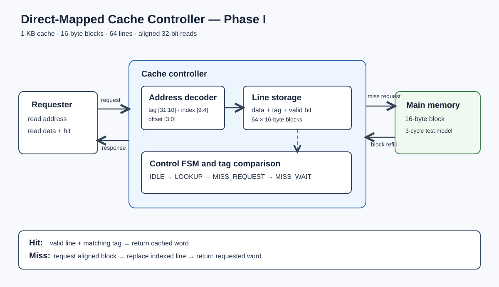

# Direct-Mapped Cache Controller — Phase I

This repository contains a **read-only, direct-mapped cache controller** written in SystemVerilog, a simulated main memory, and a self-checking testbench. It is the Phase I prototype for the Modern Computer Architecture project.



A PNG copy for slides and documents is at `docs/cache_block_diagram.png`.

## Configuration

| Property | Value |
|---|---:|
| Address width | 32 bits |
| Cache capacity | 1,024 bytes |
| Block size | 16 bytes |
| Lines | 64 |
| Words per block | 4 |
| Tag / index / offset | 22 / 6 / 4 bits |
| Simulated main-memory capacity | 4,096 bytes |
| Simulated main-memory latency | 3 clock cycles |

Address mapping: `tag = address[31:10]`, `index = address[9:4]`, and `block offset = address[3:0]`. The CPU-side prototype supports **aligned 32-bit reads**. It accepts one request at a time. On a hit it returns the selected cached word; on a miss it requests an aligned 16-byte block, fills the indexed line, and returns the selected word. Reset clears all valid bits and the hit/miss counters. The data and tag arrays do not need reset because invalid lines are never used.

The arrays hold 8,192 data bits, 1,408 tag bits, and 64 valid bits: **9,664 storage bits** before the controller and counters.

The controller has four states: `IDLE` → `LOOKUP` → (`MISS_REQUEST` → `MISS_WAIT` on a miss) → `IDLE`. The `cache_line_store` module holds the data, tag, and valid arrays; `direct_mapped_cache` handles the lookup and memory handshake. The memory model is testbench-only; both cache RTL modules are synthesizable.

| State | Action | Next state |
|---|---|---|
| `IDLE` | Accept a request when `req_valid && req_ready` | `LOOKUP` |
| `LOOKUP` | Compare valid bit and tag; return data on hit | `IDLE` on hit, `MISS_REQUEST` on miss |
| `MISS_REQUEST` | Present the aligned block address until memory accepts it | `MISS_WAIT` |
| `MISS_WAIT` | Wait for the returned block, refill the indexed line, and respond | `IDLE` |

## Run the prototype

Install [Icarus Verilog](https://steveicarus.github.io/iverilog/) and run:

```sh
make test
```

The command compiles the modules, runs the self-checking testbench, writes the console output to `results/simulation.log`, and writes a VCD waveform to `results/cache.vcd`. Open the VCD in GTKWave or another waveform viewer. A failing data, hit/miss, counter, or memory-request check terminates the run with an error.

## Verified simulation results

The testbench resets the cache between traces. “Average cycles” measures cycles from request issue to response under the included 3-cycle main-memory model; it is specific to this RTL handshake and testbench. For these traces, hits take 2 measured cycles and misses take 7.

| Trace | Accesses | Hits | Misses | Hit rate | Average cycles/access |
|---|---:|---:|---:|---:|---:|
| Directed correctness | 7 | 4 | 3 | 57.14% | 4.14 |
| Sequential words | 16 | 12 | 4 | 75.00% | 3.25 |
| Repeated address | 16 | 15 | 1 | 93.75% | 2.31 |
| Alternating conflict | 16 | 0 | 16 | 0.00% | 7.00 |

The sequential trace reads four words from each of four blocks. Its first access to each block misses; the next three hit. The repeated trace has one compulsory miss followed by fifteen hits. The conflict trace alternates `0x00000000` and `0x00000400`, which have the same index but different tags, so each access evicts the previous line.

The conflict trace is an **always-miss comparison** using the same controller and memory model: it averages 7.00 cycles per access. Sequential and repeated traces average 3.25 and 2.31 cycles because they have more hits. These are trace-level simulation measurements, not a comparison with a separately implemented uncached architecture or a hardware clock-frequency claim.

## Generic synthesis check

Run `make synth` to synthesize the cache modules with Yosys. The current generic synthesis completed with **0 design-check problems** and reported **29,525 cells** (including one scope-information pseudo cell); see `results/synthesis_summary.md` and the full `results/synthesis.log`. Yosys flattened the line arrays into registers in this technology-independent flow. These numbers are **not FPGA LUT/BRAM utilization** and do not provide a maximum clock frequency. FPGA-targeted synthesis and timing analysis need an actual target device and tool flow.

## Repository contents

| Path | Purpose |
|---|---|
| `rtl/cache_line_store.sv` | Synthesizable data/tag/valid storage |
| `rtl/direct_mapped_cache.sv` | Synthesizable controller and memory interface |
| `tb/main_memory_model.sv` | Testbench-only memory with fixed latency |
| `tb/tb_direct_mapped_cache.sv` | Self-checking directed and trace tests |
| `docs/cache_block_diagram.svg` | Architecture diagram for the report/video |
| `docs/cache_block_diagram.png` | Raster copy for slides and documents |
| `docs/PHASE1_HANDOFF.md` | Report plan, video script, submission checklist |
| `results/simulation.log` | Recorded passing simulation output |
| `results/cache.vcd` | Waveform from the test run |
| `results/synthesis_summary.md` | Generic synthesis result and limitations |

## Scope and next phase

Phase I implements reads, lookup, valid-bit handling, block refill, hit/miss statistics, simulation evidence, and a generic synthesis check. Phase II can add a documented write policy (for example, write-through with write-allocate), broader verification, FPGA-targeted timing/resource results, and the final results/discussion section. Do not describe write operations or FPGA deployment as completed Phase I features.

## Team information

Add the five members' names, actual contributions, report PDF, and prototype video link here before submission. Each member should commit their own work so the repository history reflects the work accurately.

- **Members:** To be filled by the team.
- **Phase I report:** Add the file and link here.
- **Prototype video:** Add the shareable video link here.

